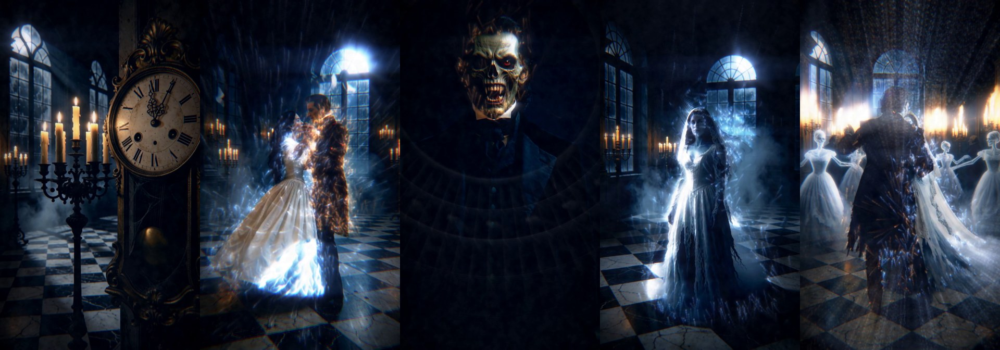
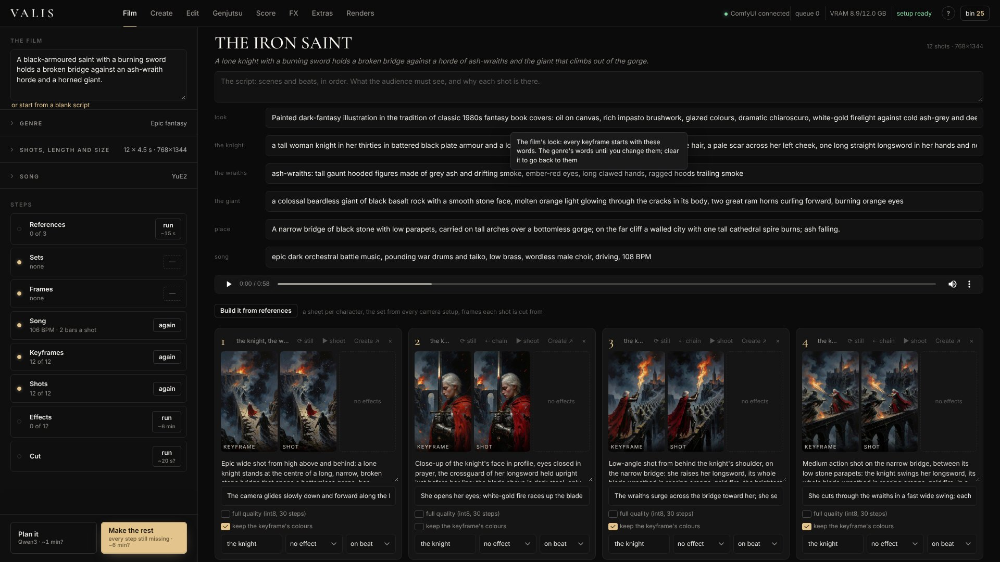
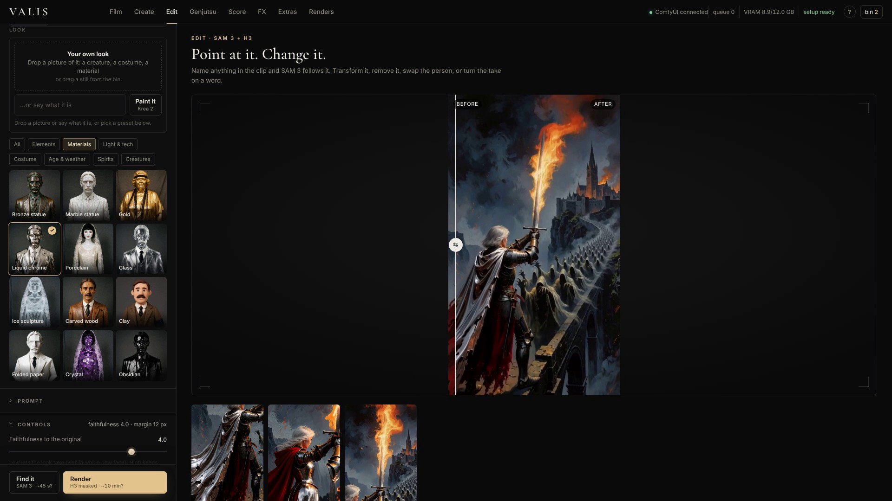
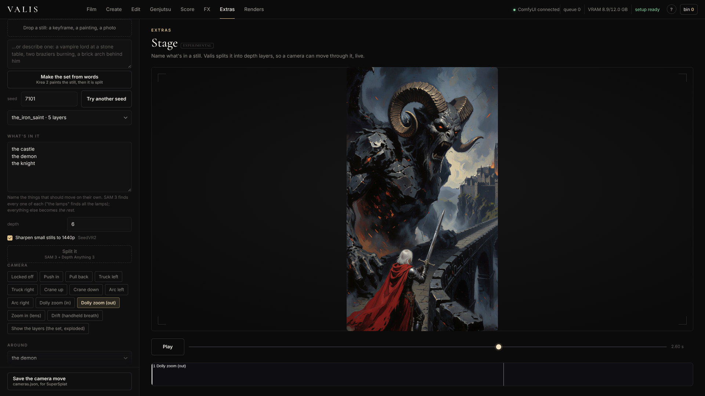

# Valis

**One line in, a scored and cut short film out, on a 12 GB laptop.** Valis is an open studio for ComfyUI. Say what the
film is about: a local Qwen3 writes the shot list and the song brief, YuE2 writes and performs the song, Krea 2 frames
every shot, MiniMax H3 shoots it, SAM 3 tracks the subject, a library of effects fires on the song's own lanes, each with its
own synthesized sound, and the cut lands on the bars. Around it: Higgsfield's Cinema Studio and Genjutsu rebuilt on open
weights, a name-it-and-change-it editor, and the cue engine that drives all of it from any song, voice line or sheet music.



**[Demo video](https://www.youtube.com/watch?v=dMsSAKzth6g)** · [Install](docs/install.md) · [Your first film](docs/first-film.md) · [Guides](docs/README.md) ·
[Workflows](workflows/) · [CLI](docs/cli.md) · built for #OpenSourceHiggsfield · open weights only · MiniMax H3 is the video model

## One line, one film

Type what the film is about and press **Plan it**. A local Qwen3 (ComfyUI's own text generation, on the Qwen Image
encoder already on disk) writes the plan as something you can edit: title, cast, place, a song brief, and a line per
shot with its framing, its motion, what to track and which effect fires on which lane. Press **Make the rest**: YuE2
writes the sheet music and performs it; Krea 2 frames every shot in one pass; MiniMax H3 shoots each one; SAM 3 tracks
the shot's subject; the library fires the shot's effect on the song's lane and synthesizes its sound in the song's key,
each shot at its own place in the song; and the cut lands every shot on the bars. Six shots is about 25 seconds of film
and about an hour on a 12 GB card. Nothing is prompted by hand and nothing leaves the machine.

A story with the same people across many cuts needs more than words: painted one by one, every still is a new room,
new faces and a new head count. **Build it from references** instead. Each character gets a sheet: a costume-test
portrait (Krea 2); a state of one, like a drowned bride, is a Krea 2 identity edit of her sheet; a prop, like their
wedding photograph, is made from both sheets. The set gets an empty plate per camera setup (a reverse angle turns the
empty plate; turning a frame with people in it brings them back twice). A frame seats the sheets into a setup's plate
as the blocking says (Qwen Image 2.1, every reference in one pass), and every later moment (a trance, a wet chair,
someone arriving, someone gone) is one edit of that seated frame, never of the moment before, so nothing changes that
the script doesn't change. A shot is a frame, or a close-up box dragged on one and enlarged by SeedVR2, which keeps
the pose and the faces the frame has.

The same chain runs headless, for people and for agents:

```sh
node cli/valis.mjs film --idea "a lighthouse keeper rows out into the storm to bring back the woman the sea took" --genre gothic --shots 6
```

## Try it in five minutes, no model needed

[Install](docs/install.md), open **http://127.0.0.1:8188/valis**, click **FX**. Drop any clip, drop any song, stack three effects,
press **Render**. The cue engine reads the kicks, snares, hats and beats of the song and every effect fires on the lane
you name. Nothing in that path touches a diffusion model: it runs on the CPU in about a minute per four seconds of video,
and every effect brings its own synthesized sound, set under the music. **Score** has the DANSE MACABRE score and shots bundled, so the
score-driven pass can be played without generating anything.

## What's in it

| Tab | What it does |
|---|---|
| **Film** | A film in steps you can see and stop. Write the script yourself (or let Qwen3 draft one from a line). **Build it from references** so the same people stay in the same places: a sheet for every character, every state of one and every prop; the set, empty, from every camera setup; frames that seat the sheets into a setup and then change one thing at a time; and each shot is a frame or a close-up box cut from one. Then the song (YuE2, or **your own song**, read for its tempo and bars), every shot's keyframe (Krea 2) to look at before anything is shot (re-roll one, edit its words, or **open it in Create** and send the still or shot back), the shots (MiniMax H3), the effects and sound (SAM 3 and the Valis library, on the song's lanes), the cut (on the bars). Each step runs alone or *Make the rest* runs what's missing; the shot count, each shot's length and the size are yours, and a draft size makes a whole film fast. Plans are kept and reopen from *Recent*. |
| **Create** (Cinema Studio) | A director's panel in sections: genre, framing, focal length, camera body, lens kit, era, light source and setup, emotion, tempo, a **colour palette** (39 looks in rows, previewed live on your keyframe as you hover; the chosen look's colours are swatches you can change before you render) and one of 44 camera moves. Every option's tooltip shows the exact words it adds; your choices lead the prompt and the genre fills only what you leave on *From genre*. A **resolution** slider (draft 384 px to 1024, keyframes always full size) and a free **length** (snapped to H3's frame grid). *Frame it* makes two Krea 2 keyframes (or drop your own still); drop a character sheet to cast it in. *Shoot it* turns the keyframe into a MiniMax H3 shot. **Trained moves** (✦): with a camera LoRA installed, the move is learned, not described (360 orbit, bullet time, push-in, crane up, FPV on H3; crash zoom and arcs on Wan 2.2). **Dolly zoom** is a real trained push re-framed by *Valis Dolly Zoom*; **whip pan** is a steady pan speed-ramped by *Valis Whip Pan*. **Relight** and **light change**. Under every result: **Extend**, **Lead-in**, **Upscale** (SeedVR2). |
| **Genjutsu** | Drop a video. **Motion transfer**: up to 8 reference images become the new cast and place; SDPose skeletons carry the motion, camera and timing (H3 Fun ControlNet Union); the source audio is kept. **Restyle**: 24 looks over Canny edges. **Object swap**: name one thing, describe its replacement; SAM 3 finds it, the ControlNet inpaints only that, and the result is composited back onto the untouched plate. **Check source** runs only the pose step and *Valis Pose Check* marks where the body can't be read before a 20-minute render. |
| **Edit** | Drop a clip and name what to change ("his head", "her dress"). SAM 3 tracks it. **Transform** re-renders only the masked region in a new look: **your own** (drop a picture of it, or say what it is and *Paint it* with Krea 2; Krea 2 and H3 both see the picture), or one of 57 presets in seven groups (elements, materials, light and tech, costume, age and weather, spirits, creatures), each shown on the same costume-test sheets, and any preset can be matched to your picture. **Remove** takes a person out with the H3 Person Remover LoRA: what was behind them fills in, and everything outside the mask stays the source's own pixels. **Swap** replaces the whole person with a character sheet (dropped, or painted from words); *Match the plate* checks the take first and matches brightness, contrast, colour and grain back to the plate with no AI. **Turn** makes one take become another on a chosen word, and can turn the voice on the same word. |
| **FX** | The library: 24 effects in four groups, **light first** (flicker, firelight, lightning, a light sweep and rim light relight the shot itself, so they read as the scene's own light; glow, light shafts, glint and heat haze work with them), then camera and lens, time, and break and blend; most come with presets (a candle or a strip light, headlights or a lighthouse, a breath of frost or a whiteout). Pick a clip (and another for the effects that open onto a second scene), optionally name a subject, stack effects. Each layer listens to one lane: from a soundless cue sheet, from any song (beats, kick/snare/hat, loudness, brightness), from YuE2 writing and performing a new song (every note becomes a cue), or from a Valis score. Every effect brings its own sound, under the clip's own sound (or the song); add beds (rain, wind, sea, fire, room, neon). A clip at another frame rate (Wan 2.2's 16 fps camera moves, a phone's 30) is retimed to 24 first. On a looping clip the effects loop with it: the cues repeat and every effect is played once round first, so trails, echoes and frost carry across the join (MP4 and GIF), and the loop keeps its own sound. |
| **Score** | Make a score in Valis: from **any song** (Valis hears its beats, bars, kick, snare and hats, how loud and bright it is, and lays out sections and shots on whole bars), from a song **YuE2 writes** (every note of its sheet music becomes a lane), or from a **cue sheet**; save it as `.json` and open it again (DANSE MACABRE is the example). Map lanes to library effects, lay clips from the bin on its shots, and the **live preview** plays your clips on the music with every effect sketched as it fires. *Render all*, then *Cut it* on the bars, or *Make a film on it*. |
| **Extras** | **Stereogram**: hide whatever moves in a clip in a field of dots, as a magic-eye stereogram (parallel or cross-eyed) and a kinetogram (it exists only while it moves), drawn in squares, halftone or letters, with a check that the depth survives an upload. **Loop**: a shot that plays forever, H3 joining its end to its start ([MiniMax H3 Loop](https://github.com/pxl-pshr/ComfyUI-MiniMaxH3-Loop)), then effects that loop with it. **Stage** (experimental): name what's in a still and a camera moves through it: push in, arc, crane, dolly zoom, a handheld drift, the set pulled apart into its layers. Export the move as an MP4, or the set as Gaussian splats with the camera path for SuperSplat ([below](#stage-a-camera-for-one-still)). |
| **Renders** | The queue, *Free memory*, *Stop*, everything made (the bin, kept between sessions) to send to any tab, and **Setup**: the studio's graphs checked against this ComfyUI, with missing node packs and model files listed per feature. **Detect hardware** reads the GPU, driver, CUDA, cuDNN, attention kernels and ComfyUI's flags, and sets the safe shot size for this GPU. The **end-to-end test** renders every Create combination and every chain after it at low resolution and checks each result. |

| Film | Score |
|---|---|
|  |  |
| **Edit · Transform** | **Create** |
|  |  |
| **FX** | **Renders and Setup** |
|  |  |

## Stage: a camera for one still

Stage is in Extras and marked experimental. Drop a still (a keyframe from Create, a painting, a photograph), name what is in
it, one thing a line (`the knight`, `the demon`, `the sky`), and press *Split it*. SAM 3 finds every one of each name, Depth
Anything 3 puts them in order front to back, and Valis paints in what each layer hides behind the ones in front of it. With
Krea 2's edit nodes installed the split erases first: the things standing in the still are removed, checked gone, and set back
on top as cutouts, so a camera that moves finds real paint where a thing stood instead of a smear. That is one GPU job. After
it, every move plays live in the browser at the still's own resolution, and changing the move, its amount or its length costs
no render at all. You can also *make the set from words*: Krea 2 paints a 16:9 still and the split runs, in one job.



**The camera.** Fourteen moves: locked off, push in, pull back, truck left and right, crane up and down, arc left and right,
dolly zoom in and out, zoom in (lens), drift (a handheld breath) and *show the layers* (the set pulled apart so you can see how
it was built). A move is built around a layer you pick: a dolly zoom holds it at one size while the room stretches behind it,
an arc circles it. Moves chain with *then another move*, and a click on the sound strip starts the next one on a word or a hit.
The camera can see past the still's edge into a painted dome (*Paint what the camera uncovers*, Krea 2 AnyPaint or Qwen Image
2.1), which allows wider moves with less crop.

**On the music.** Drop a song or a voice line, or write a cue sheet, and layers get something to do on its lanes, read by the
same cue engine as FX: a lamp that glows on the kick, a fire that flickers and throws embers, smoke that rises, trees that sway,
a layer that appears on the first hit, a zoom punch on every snare. Thirteen effects in all.

**What comes out.**

| | |
|---|---|
| **MP4** | The move as a shot: H.264, 720p or 1080p at 24 fps, the dropped sound under it, saved in the stage's folder under `ComfyUI/output/valis/stage/`. These are plain clips. Cut them into a film, or use a push-in or a dolly zoom out on a keyframe as a shot you did not have to ask a video model for. The Stage showcase in the Valis demo is exports like these, all from one THE IRON SAINT still. |
| **3D set** | `<stage>_set.ply`: the layers as Gaussian splats, written in the browser, with what Valis painted behind them and the far dome around them. Opens in SuperSplat, Blender and game engines. |
| **Camera path** | `<stage>_<moves>_cameras.json`, one key per frame at 30 fps in the format 3DGS training writes. Drop it on the 3D set in SuperSplat and render at 30 fps to play the same move on the splats. |

**What to expect.** It works from one view, so the far side of things stays empty, big arcs can tear thin shapes, smoke and haze
that you did not name sit at ground depth and can streak on a big move, a very broad name ("the desert") can take the whole
picture, and a move that crops in past the still's own pixels is soft at 1080p (by default a still under 1300 px is sharpened to
1440 with SeedVR2 before the split). A *Checks* line under the viewer says what a move will show before you export: pixel tests run when
the stage was split (the first frame is the still, no ghost outlines, few torn triangles, real paint behind the things). A
modest move on a clean split cuts into a film; wide moves are where it shows. It needs SAM 3.1 and Depth Anything 3, and Krea 2
with its edit nodes for erase first and for painting past the frame; [install](docs/install.md) lists them and Setup under
Renders checks them. The full guide is in [Extras](docs/guides/extras.md#stage-experimental).

## What's new here

- **One line, one film.** The planner is open weights on disk (ComfyUI's `TextGenerate` on the Qwen3-VL 8B encoder
  that Qwen Image uses), so a film is written, scored, shot, effected and cut without a prompt typed by hand and
  without a request leaving the machine. Every shot is as long as you set it (one 4.5 s H3 clip unless you say, 2 to
  15 s) and cut to whole bars of the tempo YuE2 actually played, so the picture changes on the music's own grid.
- **Everything runs on cues.** `ValisCues` merges lanes from a Valis score, any music (a beat tracker, band onsets,
  loudness and brightness curves), a voice (syllable onsets), YuE2's ABC notation aligned to its own performance, or a
  plain-text cue sheet (`1.5 impact`, `every 1/2 beat from 3:1 to 7:1 pulse`, `ramp slip 0 0 4 1`). Every effect,
  every camera punch and every sound in Valis listens to a lane.
- **Effects as layers with a shared context** (`ValisLayer`, `ValisRender`): one context per frame holds the clip, a
  second clip, SAM masks, depth, optical flow and the frames already made, so a datamosh drags the picture along the
  real motion and an echo sheds the subject's own silhouette. Light that relights the plate rather than lying on it:
  flicker, firelight, lightning, light sweep and rim light multiply the picture by a light map, and light reaching a
  dark corner shows the surfaces there; glow, light shafts, glint and heat haze complete the light group. Double exposure, time slip,
  slit-scan, gravity lens (the real lens equation), datamosh, echo, frost, vertigo, shockwave, split time,
  era cut, tear, projector, glitch, punch.
- **Sound design that is synthesized, not sampled** (`ValisSoundDesign`): bells, swells, booms, shimmer and hums (tuned
  to the song's key: the key of YuE2's sheet music, else the key Valis hears in the song, else D minor), every hit measured (K-weighted) and set a fixed number of dB under the music, the effect bus held
  under the song, dense lanes sounding only on their accents.
- **The Valis pass** (`ValisFX`, from DANSE MACABRE): an excitable-medium reveal (a Barkley model on the SAM mask,
  carried by optical flow) that burns a transformation across a body on the beat; shockwaves, rays, mist, candles,
  glints, halo, bloom and camera punch on their own lanes.
- **Turn on a word** (`ValisScoreFromAudio`, `ValisVoiceTurn`): the voice is the score. Syllable onsets become events,
  one word becomes the impact, the face turns from the eyes on it, and the voice turns on the same word (pitch and
  formant shift, a sub-octave, a growl; no model).
- **Swap checks with no AI** (`ValisSwapCheck`, `ValisSwapMatch`): the take is measured against the character sheet
  before a swap (exposure, contrast, colour cast, noise, face size, key-light side) and the swap is matched back to
  the plate after it (tone curve, colour transfer, grain, light wrap).
- **Real camera moves from real motion** (`ValisDollyZoom`, `ValisWhipPan`, `ValisTrimHold`, `ValisPoseCheck`,
  `ValisCanny`): the vertigo shot and the whip pan are made from footage the video model shoots well, not from prompts
  it shoots badly.
- **A camera for one still** (`ValisStage` and the Stage nodes; Extras · Stage, experimental): a still split by words into
  depth layers with the paint behind them, then a live 2.5D camera, layers that act on the music, and exports as an MP4, a
  set of Gaussian splats and a camera path. See [Stage](#stage-a-camera-for-one-still).
- **Built on the Comfy SDK.** Every job (submit, live progress, uploads, results) goes through the official
  [`@comfyorg/sdk`](https://docs.comfy.org/development/api-development/sdks) over Comfy API v2. The pack mounts
  Comfy-Org's [`comfy-api-proxy`](https://docs.comfy.org/development/comfyui-server/api-proxy) on ComfyUI's own server
  (`sdk_api.py`): same origin, no second server, no CORS. The studio, the CLI and any agent run the same graphs through
  the same client; point it at Comfy Cloud or a Comfy API deployment and the same code runs there.

## Films made with Valis

Every one of these was made on the same 12 GB laptop with the tools above. All fourteen are in the [Valis playlist](https://www.youtube.com/watch?v=yYGA8gZ5ips&list=PLVmeiiCmWJdk) on
YouTube, newest first here; several are also in the demo.

| Film | What drives it |
|---|---|
| **SÉANCE** (43 s) | Made in the Film tab end to end, built from references: a sheet for each character, an empty plate per camera setup, frames seated with Qwen Image 2.1, every later moment one edit of its seated frame. 14 shots, one bar each at 85 BPM, under one red lamp. |
| **THE IRON SAINT** (61 s) | Made in the Film and Score tabs: a saint holds a broken bridge against an ash-wraith horde and a horned giant. Krea 2 stills that pin one set, MiniMax H3 shots chained in hard continuity (each starts on the last frame of the one before), scored on a composed piano score with light shafts on the beat and an end card. |
| **THE MAKING OF THE FOURTEENTH SHELL** (1:58) | A making-of featurette for THE FOURTEENTH SHELL, a film in a graphic-novel look (Krea 2 with a style LoRA). The people in it speak their lines in their own MiniMax H3 voices; `tools/asr.py` caught the takes that dropped or invented a line. |
| **THE MAN IN THE SUIT** (2:05) | A straight-faced featurette about the people who say they were inside the 1966 rehearsal suit. Every person in it is invented and speaks in their own MiniMax H3 voice; the library's Projector turns the reel into worn 16 mm (flicker, gate weave, scratches, dust). A YuE2 instrumental score. |
| **BLUE RIBBON** (53 s) | A 1960s Technicolor caper about a county-fair pie. Every line is spoken by H3 in the shot; trained moves, a dolly zoom, a Wan crash zoom, and a keyframe relit from the daytime fair to the barn at night. A YuE2 score with no lyrics. |
| **BURN SEASON (TRAILER 3)** (79 s) | Built job by job with the studio's own graph builders: Krea 2 keyframes in 35 mm anamorphic with Super 8 inserts, MiniMax H3 shots with their own voices, trained moves, a dolly zoom and a Wan crash zoom, to a YuE2 score with no lyrics. |
| **OCCUPIED** (61 s) | An animated comedy short: Krea 2 keyframes in a 3D-feature look, MiniMax H3 shots with their own voices, a YuE2 score with no lyrics. |
| **BURN SEASON (TRAILER 2)** (71 s) | Cinema Studio end to end: every trained move (crane, push-in, FPV, crash zoom, arc, bullet time), dolly zoom, whip pan, relight, object swap and extend, on Krea 2, MiniMax H3, Wan 2.2 and Qwen Image, to a YuE2 song from Valis's sheet music. |
| **GLASS** (44 s) | YuE2 at 108 BPM. Glitch on the hats, datamosh on the kick, frost on the glass, echoes on the snare, a dolly zoom down the corridor, slit-scan on the tracks, a gravity lens on the eye. |
| **BLACK SUN** (43 s) | An eclipse over a desert procession: the gravity lens on the sun, shockwaves on the drops, the boy's eyes on the ring. YuE2 from Valis's sheet music. |
| **THE UNDROWNED** (47 s) | *Wade in the Water* performed by YuE2: an underwater church, a ghost procession in the river, double exposures over the old photograph. |
| **DANSE MACABRE** (83 s) | A Valis score. The reveal burns across the dancers on the kicks; version 4 adds the ballroom of 1843, bleeding through on the strings and cutting in on every *oom* of the waltz. |
| **LAST LIGHT OF ENROTH** (49 s) | A painted fantasy: light shafts, lightning and lantern glows fired by the track, a lich king and a bone dragon in oils. |
| **BURN SEASON** (44 s) | The film: double exposures of the two leads over the burning cane and the swamp, a photograph that burns through on the hits. |

## Install

Valis needs ComfyUI 0.39 or newer (it was built on 0.42.0). On the Windows portable build:

```bat
cd ComfyUI\custom_nodes
git clone https://github.com/Graceus777/ComfyUI-Valis
..\..\python_embeded\python -m pip install -r ComfyUI-Valis\requirements.txt
```

Elsewhere, clone into `ComfyUI/custom_nodes/` and install `requirements.txt` with the Python that runs ComfyUI.
Restart ComfyUI and open **http://127.0.0.1:8188/valis**, or click **VALIS** in the ComfyUI menu. The **setup** pill
in the top bar says which features are ready; click it to see exactly what each one still needs. The FX and Score tabs
need no model at all.

[docs/install.md](docs/install.md) has the rest: the node packs, the models each feature needs (with a table by
feature and every file with its folder and source), the optional camera-move LoRAs, the model licences, and how to
check the install. The studio makes no request off this machine: its fonts and the Comfy SDK are bundled.

## Use it

**In the studio:** open `/valis`. Hover anything for what it does; press **?** for how the tabs work together. Everything
you make lands in the **bin** (bottom right): click an item to send it to another tab, or drag it onto a drop zone or a
Film shot. Every button's time is learned from this machine's own past jobs (a `?` means it hasn't run that kind of job
here yet). Renders land in `ComfyUI/output/valis/`.

Each tab has a guide: [Film](docs/guides/film.md) · [Create](docs/guides/create.md) · [Edit](docs/guides/edit.md) ·
[Genjutsu](docs/guides/genjutsu.md) · [Score](docs/guides/score.md) · [FX](docs/guides/fx.md) · [Extras](docs/guides/extras.md) ·
[Renders](docs/guides/renders.md). The references list every [effect](docs/reference/effects.md), every
[lane and the cue-sheet grammar](docs/reference/cues.md) and every [node](docs/reference/nodes.md). Start with
[Your first film](docs/first-film.md); if something doesn't work, see [Troubleshooting](docs/troubleshooting.md).

**As workflows:** [`workflows/`](workflows/) has every graph the studio sends, in API format. Drag one onto the
ComfyUI canvas, point its Load nodes at your files, and queue it. `node tools/export_workflows.mjs` regenerates them.

### Headless: the CLI and agents

`cli/valis.mjs` runs the same graphs through the same Comfy SDK, uploading local files and downloading the results.
It needs Node 18+ and nothing else.

```sh
node cli/valis.mjs film --idea "a lighthouse keeper rows out into the storm to bring back the woman the sea took" --genre gothic --shots 6
node cli/valis.mjs film --idea "..." --plan-only > plan.json      # edit it, then: valis film --plan plan.json
node cli/valis.mjs frame --prompt "a lighthouse keeper on a rocky shore at night, holding a lantern" --genre gothic --body 16mm --look noir
node cli/valis.mjs shoot --image key.png --motion "he raises the lantern and turns to the sea" --move crane_up --anchor
node cli/valis.mjs swap --video take.mp4 --character vampire_sheet.png --background ballroom.png --person man
node cli/valis.mjs turn --a take_as_the_man.mp4 --b take_as_the_vampire.mp4 --at 3.8
node cli/valis.mjs transform --video clip.mp4 --target "his head" --look bronze
node cli/valis.mjs transform --video clip.mp4 --target "the man" --ref stag_spirit.png --words "a stag-headed spirit of bark and moss"
node cli/valis.mjs run workflows/14_genjutsu_motion_transfer.json --set v.file=dance.mp4 --set ref0.image=cast.png
node cli/valis.mjs help
```

`frame` and `shoot` take Create's choices by id and go through Create's own planner, so they make what its buttons
make. A bad command line (an unknown id, a misspelt option, a missing value) stops with exit code 2 and says what is
valid, before anything is sent. The CLI prints a JSON summary (job id, seconds, output files), so a coding agent can
drive Valis directly. That's how *DANSE MACABRE* and the demo's cold open were produced: by describing the shot to an
agent that built and queued these graphs. `--api` / `--key` point the CLI at Comfy Cloud or a Comfy API deployment.
Every command and flag is in [docs/cli.md](docs/cli.md).

## How it's built

- **The pack:** `__init__.py` serves the studio at `/valis` and mounts Comfy API v2 (`sdk_api.py`). `nodes.py` holds
  `Valis Score (load)`, `Valis Score (from a voice)` and `Valis FX (score-driven pass)`; `nodes_lib.py` exposes the
  library (cues, layers, render, sound design, swap check and match, voice turn, colour palette, trim hold, dolly zoom,
  whip pan, batched Canny, pose check). `nodes_stereo.py` hides pictures in noise: SAM 3 masks, Depth Anything 3 or
  spinning solids become a magic-eye stereogram or a kinetogram (motion-only), drawn in a static you choose (squares,
  halftone, or characters such as ASCII ramps, a 10 PRINT maze or katakana; noise colours; RGB, colour-TV or Valis's own palettes), with a decoder that checks the depth
  survives H.264 (`workflows/32`). `model_routes.py` fetches a missing model file from Hugging Face when you ask.
- **The studio:** plain ES modules under `app/`, with no build step. `api.js` is the SDK client. `film.js` is the film
  chain, run by the Film tab and by `valis film` through the same SDK. `graphs.js` has every workflow as an API-format
  builder. `presets.js` holds the director's panel and the looks. `score.js` is the timeline.
  `fx.js` is the library tab. `check.js` is the setup check. `create.js` turns the director's panel into prompts and
  graphs (the Create button, the end-to-end test and the CLI share it). `grade.js` is `palette.py`'s grade in the browser
  (the live palette preview); `livefx.js` sketches the library's effects live for the Score preview. `estimate.js` and
  `work.js` learn job times from this machine; `bin.js` is the bin; `machine.js` reads the hardware (with
  `machine_routes.py`); `selftest.js` is the end-to-end test. Stage is `stageview.js`, `stage3d.js`, `nodes_stage.py`
  and `stage_routes.py`. `app/vendor/comfy-sdk.js` is `@comfyorg/sdk` bundled for
  the browser by `tools/build-sdk/`.
- **The engine:** `valis_fx/` (numpy and OpenCV, CPU). `engine.py` is the score-driven pass, `forge.py` the shared
  light, particle and grade tools, `post.py` the excitable reveal. `valis_fx/lib/` is the library: `cues.py`, `audio.py`
  and `abc.py` (cues from scores, songs, sheet music and voices), `core.py` (clips, masks, flow, the render loop),
  `effects.py`, `light.py`, `sound.py`, `match.py`, `voice.py`, `dolly.py`, `whip.py`, `posecheck.py`, `palette.py`.
- **Machine controls:** free memory, stop, VRAM, the node list and the render gallery use ComfyUI's own endpoints,
  because Comfy API v2 doesn't cover them.

## Testing

- `node tests/graphs.test.mjs`: every graph the studio can send, and Create across every camera move, aspect, size and
  option, built with the same planner the buttons use and checked against a ComfyUI node list (40,000+ checks, no GPU).
- `node tests/cli.test.mjs`: the CLI against a stand-in ComfyUI, with nothing uploaded or queued: `frame` and `shoot`
  build what Create's buttons build, bad ids, options and plan files exit with code 2, a graph ComfyUI turns down exits 1 naming the
  node and input, and `film --plan` sends a picture
  in ComfyUI's input folder as an input file; `run --set` gives a value the type its input declares (`false` is false, `2025` in
  a text input stays text, a bare `--set` is a usage error), and `--json` names a file of yours instead of uploading it.
- `node tests/jobs.test.mjs`: following a job on a stand-in for Comfy API v2: a job ComfyUI has forgotten (a restart) or that
  stopped answering is reported lost instead of polled for ever, and a poll that fails for a moment is retried.
  A model download is followed the same way: to its end, and let go of when ComfyUI no longer has it.
  What is installed (a node, an input, a LoRA, a model patch) is asked again after a "no" and never remembered from an answer ComfyUI couldn't give.
- `python tests/check_grade.py`: the browser's live colour grade against `palette.py`'s (within 0.2 levels on every look),
  a negative contrast flattens the picture in both, and your own colours (`#rgb` as well as `#rrggbb`) grade the same in both.
- `python tests/check_cues.py`: cue-sheet errors (capitals, empty ranges), sheet music (strengths; broken rhythm, tuplets, comments,
  decorations and grace notes keep every later hit on its beat), one beat grid for a song with its sheet music,
  the key heard in a song, where the voice turns (a score with no impact in it turns it at the start), the effects that should be heard, and every classic Score engine mode on a score with no events
  (no ComfyUI, no GPU).
- `python tests/check_stage.py`: a stage folder's files stay inside the folder (a crafted `stage.json` can't read or
  overwrite pictures elsewhere), the plate still paints a stage's own layers, a second pass at the plate keeps what the first
  left standing, an erased thing keeps its layer, and Stage Fill
  paints only what is hidden (the first frame stays the still) (no ComfyUI, no GPU).
- `python tests/check_stage_routes.py`: the Stage export routes on a real aiohttp server with a stand-in for PyAV: encoding runs
  off the server's loop, and an export that fails, repeats its id, is aborted or goes quiet is closed and its half-written
  video deleted, and an audio name that points outside ComfyUI's input, output and temp folders (`../x`, `/x`, a symlink) is
  refused (needs `pip install aiohttp`; no ComfyUI, no GPU).
- `python tests/check_model_routes.py`: the model download routes on a real aiohttp server with a stand-in for Hugging Face: code
  folders, a repo or path with a `.` or `..` step, and cross-site or remote requests are refused, a download can't outgrow its size or the disk, one file name in two
  folders is two downloads, and a file is hash-checked before it is put in place (needs `pip install aiohttp`; no network).
- `python tests/check_match.py`: Swap Check and Swap Match read the grain there is (white grain of σ 8 reads as 8, not 3), and a swap
  given the plate's grain ends with it, and the light wrap stays on the subject's rim (no halo in the backdrop)
  (no ComfyUI, no GPU).
- `node tests/ui/run.mjs`: the studio clicked through in a headless browser against a stand-in ComfyUI
  (`tests/ui/mock_server.mjs`), with a screenshot of every screen.
- `node tests/ui/film_save.test.mjs`: the Film tab's saves: a reopened film keeps its shot length, your own song survives a
  reload, and a save waiting when you switch films lands in its own film.
- `node tests/ui/compare.test.mjs`: the before/after divider follows a drag even outside the picture, and each one made adds
  no window listeners.
- `node tests/ui/film_build.test.mjs`: the Film tab's reference, set and frame cards: renaming a character follows into every
  frame's "gone" list, and a setup or frame named with a colon can be picked.
- `node tests/ui/palette_pick.test.mjs`: Create's colour picker keeps the swatch's input through every change made in it (the
  browser's picker is open on that input), and the name and reset button follow the edit.
- `node tests/ui/film_still.test.mjs`: a still dropped on Create from disk and sent to a Film shot is kept as one of ComfyUI's
  input files, once, never as a blob: URL.
- `node tests/ui/score_open.test.mjs`: a Valis score you open is shown as text, whatever its title, bars or names hold.
- `node tests/ui/stage_export.test.mjs`: Stage's MP4 export on a stand-in server: a frame that fails to upload gets the export
  dropped, and two stages opened at once, or one opened during an export, never mix their layers.
- `node tests/ui/setup_optional.test.mjs`: the full-quality (30-step) shot is offered only where its model file is: without it, Setup
  doesn't list it and the shot card's box is greyed with the file's name in its tip; with it, the row is checked and the box works,
  and a shot already saved as full quality keeps a box you can untick.
- `node tests/ui/stage_ui.test.mjs`: Stage's controls under a click: a "then" move's start box keeps the focus when clicked, Try
  another seed during a Make starts no second set and leaves the button as it was, a second dropped song stops the first, and
  choosing a move while it plays starts no second play loop.
- **Renders → End-to-end test** (or `(await import("/valis/app/js/selftest.js")).run()` in the browser console): short,
  low-resolution renders on the GPU through the studio's own code. 15 Create combinations (IMAX 65mm + fisheye + 1950s
  + noir, Super 8, VHS, trained moves, Wan, custom palettes, an end frame, a loop, relight, a cast character), then the
  chains after them: extend, lead-in, upscale, find, transform, remove, swap, turn, Genjutsu's three modes and source
  check, FX on a cue sheet, a song, a YuE2 song and a loop, the stereogram, a score made from a song and cut on its bars,
  a film from one line, and Stage. Every output is checked for size, length, motion, monochrome and sound.

## Timings on an RTX 4080 Laptop (12 GB VRAM, 32 GB RAM)

| Step | Time |
|---|---|
| Film · plan (Qwen3, with the model load) | ~2 min |
| Film · 6 shots, start to finish | ~1 h |
| Frame it (2 Krea 2 keyframes) | ~40 s |
| Cast a character (Krea 2 identity edit) | ~80 s |
| Shoot it (4.5 s H3 shot, 8 steps) | ~7 min |
| Find it (SAM 3 track) | ~35 s warm, ~2.5 min cold |
| Transform (masked H3 re-render) | ~12 min |
| Swap (6 s take, turbo, 8 steps) | ~15 min |
| Turn / Valis pass | 1–2 min (CPU) |
| FX library stack | ~1 min per 4 s of video (CPU) |
| New song (YuE2, 20–40 s) | ~45 s |
| Trained camera move, H3 (4.5 s) / Wan 2.2 (5 s, 720p) | ~7 min / ~9 min |
| Dolly zoom (trained push + SAM 3 + re-frame) | ~8 min |
| Genjutsu, 5 s at 480p (motion transfer, restyle) | ~6 min |
| Genjutsu source check (SDPose + Valis Pose Check, 10 s clip) | ~3–4 min |
| Extend (5 s more) / Upscale to 1080p (5 s) | ~2.5 min / ~7 min |

Run **Free memory** between big jobs on a 12–16 GB card: H3 image-to-video and H3 ref2va don't fit side by side.
*Keep the clip's own sound* (Edit) feeds the clip's audio to H3. Untick it for silent clips.

## Licenses

Valis is GPL-3.0 (see `LICENSE`). `app/vendor/comfy-sdk.js` bundles `@comfyorg/sdk` (MIT) with zod, hash-wasm and
eventsource-parser (MIT); `app/vendor/fonts/` bundles Inter and Cormorant Garamond (SIL Open Font License). Models and
node packs keep their own licenses; read each model card before you use its output (see
[model licences](docs/install.md#model-licences)). The DANSE MACABRE score, pictures and cold open were made for this project.
