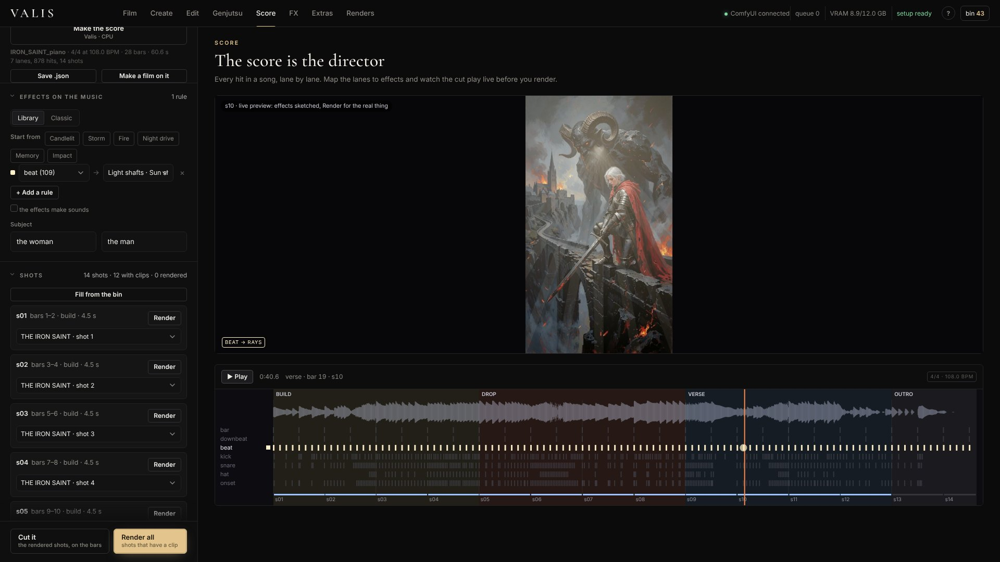
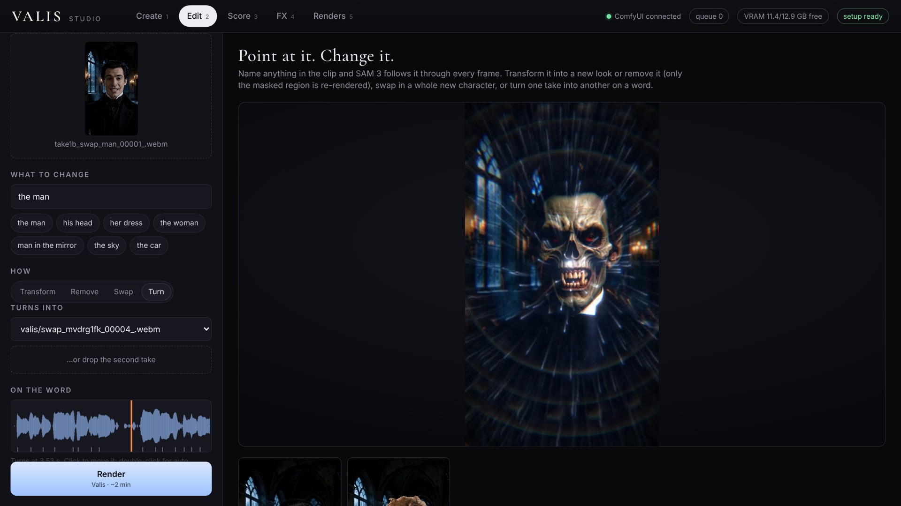
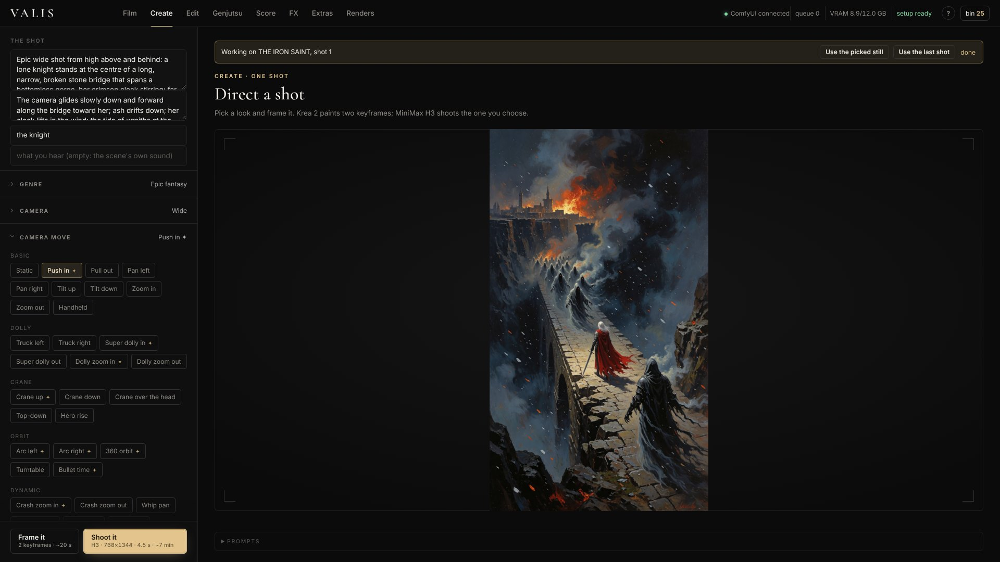
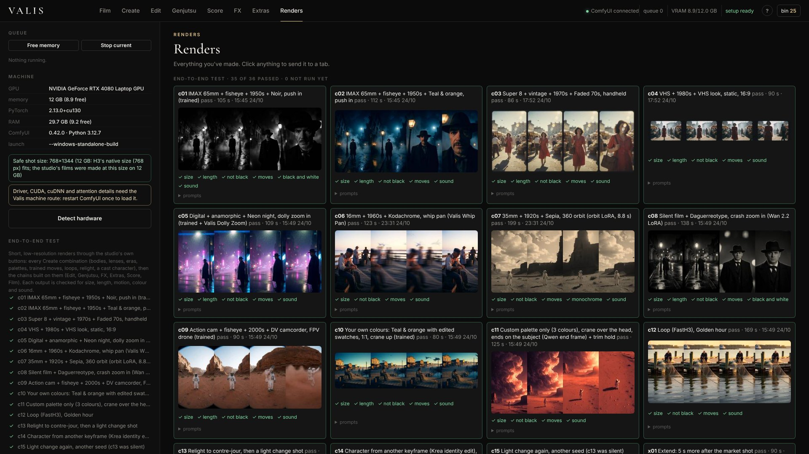
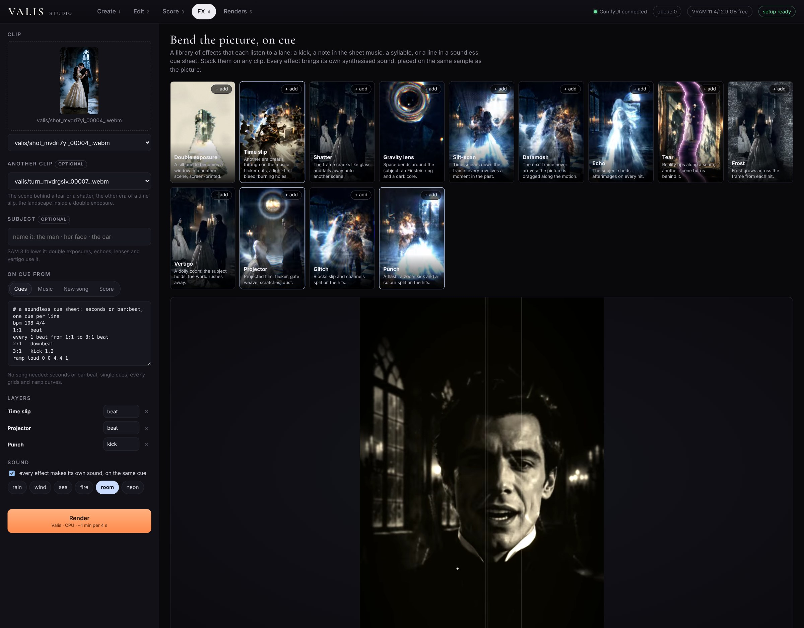

# Valis

**Direct a still like a set.** Name what's in a picture and Valis cuts it into real depth layers, paints in what each
one hides, and puts a camera inside it: push in, arc, crane, dolly zoom, all previewed live at the still's own
resolution. Then give each named thing something to do, and say *when*: the lanterns glow on every kick, the fire
throws embers on every syllable, the dolly zoom starts on the word "morning".

*Select what. Direct how. Trigger when.*

- **What**: plain words for SAM 3 (`the lamps` finds every lamp). Depth Anything 3 orders them. Valis completes each
  layer behind the ones in front, so a moving camera reveals paint, not holes or rubber sheets.
- **How**: a real pinhole camera in WebGL with auto-framing (the picture's own edges never show, and the studio says
  what that costs in resolution), plus per-layer light, bloom, embers, sparks, sway, drift and more.
- **When**: the same cue engine as the rest of Valis: any song (kick, snare, hat, beat, downbeat), a voice (every
  syllable), or a plain-text cue sheet. Click the sound strip to start a camera move on a word.

Splitting a still is one short GPU job (SAM 3 + Depth Anything 3 Small, seconds on a 12 GB laptop). After that, every
camera move, amount, subject, effect and trigger plays live with **no new diffusion job**, and the export draws exactly
the frames the preview drew. It is built for low-VRAM machines on purpose: video diffusion stays an option for the one
element that needs it, not the camera.

Naive checks run before anything costs time: a name that finds nothing, a name that matches the whole picture, or two
names that found the same thing are reported and left out instead of breaking the stage.

Valis also keeps its earlier tools, as options that work on 12 GB with care: score-driven VFX, character swap and
"turn on a word", and open rebuilds of Higgsfield's Genjutsu and Cinema Studio on MiniMax H3, Krea 2 and Wan 2.2.

**[Demo video](#)** · [Workflows](workflows/) · [CLI](#headless-the-cli-and-agents)

---

## What's in it

| | |
|---|---|
| **Stage** | Drop a still and name what's in it. *Split it* runs SAM 3 for each name and Depth Anything 3 Small for depth; Valis Stage builds the layers. Then: a live 2.5D camera (push, pull, truck, crane, arc, dolly zoom, lens zoom, drift, and *Show the layers*, which pulls the set apart so you can see it), camera sequences (one move, then the next on a chosen word or hit), per-layer direction (glow, flicker, pulse, appear, vanish, drift, rise, sway, shake, dim, embers, sparks, motes) on any cue lane, and export to MP4 with the sound. A still under 1300 px on its short side is **sharpened to 1440p with SeedVR2** inside *Split it*, so 1080p exports and push-ins stay crisp. Every stage gets a **far dome** (the world past the frame, blurred out from the still's own edges): with *Show the dome* the camera may see past the edge and the set fades into it, so moves need less crop. *Split it* and *Make the set from words* **erase first**: Krea 2 edit removes the people and things standing in the scene (all of them, and the biggest alone), SAM 3 checks the edit for a thing it only moved, Valis builds the erased picture part by part from whichever edit really removed each part (matched to the still in colour and light), splits it as the scenery, and puts the things back on top as cutouts from the still. A move then uncovers real paint behind them, the glow and halo of every outline go with it instead of staying on the sky as a ghost, and at rest the picture is exactly the still (~2 min more). **Paint what the camera uncovers** has Qwen Image 2.1 paint the still out to twice its size (with the outpaint LoRA), so the dome becomes that painted world (~1 min); on a set split before erase-first it also has Krea 2 edit paint a clean plate behind the people and things (~3 min). No still yet? **Make the set from words**: describe the scene, Valis suggests the names from the description, and one job paints the still with Krea 2, sharpens it and splits it (~2 min). **Save the 3D set** writes the stage, dome included, as Gaussian splats (.ply) for SuperSplat, Blender (natively from 5.3), Unreal and Unity, in the COLMAP axes those tools expect (x right, y down, +z ahead), and **Save the camera move** writes the studio's move as a SuperSplat camera file (one key per frame at 30 fps): drop it on the set and render the same move there. |
| **Create** (Cinema Studio) | A director's panel: describe the shot, then pick genre, framing, lens, camera body, era, light, emotion, tempo, colour palette and one of 44 camera moves. *Frame it* makes two Krea 2 keyframes. Drop a character sheet to cast it into a keyframe. *Shoot it* turns the chosen keyframe into a MiniMax H3 shot. **Trained moves** (on by default): when a camera LoRA is installed for the chosen move, the move is learned rather than described (360 orbit and bullet time, push-in, crane up, FPV fly-past on H3; crash zoom and arcs on Wan 2.2). **Dolly zoom** is a real trained push-in (or pull-back) re-framed by *Valis Dolly Zoom* so the subject keeps one size while the background's perspective keeps changing. **Whip pan** is a steady real pan from H3, speed-ramped by *Valis Whip Pan* into a whip with the camera's own motion blur (no dissolve between views). **Relight** re-lights the picked keyframe with Qwen Image edit (10 presets); **light change** shoots from the keyframe to its relit version so the light shifts during the shot. Under every result: **Lead-in / Extend** (the clip's edge frames anchor a new H3 shot, sound included), **Upscale** (SeedVR2, 1080p+) and a **Color Palette** grade (39 looks or your own HEX colours). |
| **Genjutsu** | Drop a video. **Motion transfer**: up to 8 reference images become the new cast and place, and SDPose skeletons carry the original motion, camera and timing (H3 Fun ControlNet Union on H3 ref2va); the source audio is kept. **Restyle**: 24 looks over Canny edges, same motion. **Object swap**: name one thing ("his robe"), describe or show its replacement; SAM 3 finds it, the ControlNet inpaints only that, and the result is composited back onto the untouched plate. **Check source** (Motion Transfer) runs only the pose step (about a minute) and *Valis Pose Check* marks where the body can't be read (hidden legs, a spin, leaving the frame) and the best window to render, before a 20-minute render. |
| **Edit** | Drop a clip and name what to change, like "his head", "her dress" or "the man in the mirror". SAM 3 tracks it, and *Find it* shows the matte. Then pick a mode. **Transform** re-renders only the masked region in a new look (vampire, bride, ghostfire, smoke, chrome, stone, skeleton, fire). **Remove** paints the target out. **Swap** replaces the whole person with a character sheet, optionally on a new background; *Match the plate* (on by default) checks the take first and then matches the swap's brightness, contrast, colour and grain to the plate, with no AI involved. **Turn** makes one take become another on a chosen word, and can turn the voice on the same word (deeper, a bigger throat, a growl). A before/after wipe compares the result with the source. |
| **FX** | The library. Pick a clip (and another one for the effects that open onto a second scene), optionally name a subject for SAM 3, then stack effects. Each layer listens to one lane. The lanes come from *Cues* (a soundless cue sheet), *Music* (beats, kick/snare/hat, loudness and brightness of any song), *New song* (YuE2 writes the sheet music and performs it; every note becomes a cue) or the DANSE *Score*. Every effect brings its own sound; add beds (rain, wind, sea, fire, room, neon). |
| **Score** | Load a score (the DANSE MACABRE score is built in). A lane timeline shows every event. Map events to effects (impact → halo, kick → ignite, stroke → shockwave, melody → candles), give each 4-bar shot a clip and a transformed layer from Edit, and *Render with Valis*. |
| **Renders** | The queue, VRAM, *Free memory*, *Stop*, and everything made so far. **Setup** checks every workflow the studio can send against this ComfyUI and lists what's missing for each feature before anything is queued: node packs, model files, renamed inputs and broken links. |

| Score | Edit · Turn |
|---|---|
|  |  |
| **Create** | **Renders and Setup** |
|  |  |



### The parts that are new

- **Valis FX: effects driven by the score** (`ValisFX` node, `valis_fx/`).
  - The reveal is an excitable medium (a Barkley model) living on the SAM 3 mask and carried along by optical flow.
  - Score events seed it at tracked points (the hem, the shoulders, the eyes), so a transformation burns across the body on the beat.
  - Shockwaves, rays, mist, candles, glints, the halo, bloom and camera punch all listen to their own event lanes.
  - `remap` moves an effect to another lane, e.g. candles on the melody.
- **A score from a voice** (`ValisScoreFromAudio`).
  - Reads syllable onsets from a speech track and picks the turn point: by default the first syllable after the longest pause, or a word you click on the waveform.
  - The reveal ignites from the eyes on that word, and later syllables keep feeding it. That's how the cold open of the demo turns into the vampire on *"…what we can do"*.
- **Name it, then change it.**
  - The target is plain words for SAM 3. The effect is a look, a removal or a character.
  - Only the masked region is re-rendered: MiniMax H3 ref2va with Krea 2 first and last anchors, with no extra LLM layer.
- **The Valis library** (`valis_fx/lib/`, nodes `ValisCues`, `ValisLayer`, `ValisRender`, `ValisSoundDesign`).
  - Effects are layers. Each has `on=` (the lane that fires it) and/or `by=` (a held amount: a curve, or a lane's envelope).
  - They share one context per frame: the clip, a second clip, SAM masks, depth, optical flow and the frames already made, so a datamosh can drag the picture along the real motion and an echo can shed the subject's own silhouette.
  - **Double exposure** is the *True Detective* title look: the SAM silhouette is a window onto another scene, screen-printed, with halftone and misregistration on the hits. **Time slip** lets another era break through: hard flicker cuts, a light-first bleed, or holes that burn open with a glowing rim. **Shatter** cracks the frame into glass shards that fall onto the next shot. **Gravity lens** bends space around the subject (the real lens equation, so you get an Einstein ring). **Tear** rips reality along a seam. **Frost** grows in from the hits.
- **Cues from anything** (`cues.py`, `audio.py`, `abc.py`).
  - Any music: a beat tracker, band onsets (kick, snare, hat) and loudness, brightness and band curves.
  - YuE2's sheet music: YuE2 plans every song as ABC notation before it sings. Valis parses it (melody, bass, chords, bars, sections) and aligns it to the performance, so an effect can fire on the second note of the bass line.
  - A cue sheet: plain text, seconds or `bar:beat`, `every 1/2 beat from 3:1 to 7:1`, and `ramp` curves. No song needed.
- **Music and sound.**
  - *New song* writes the music for a shot with YuE2 (native ComfyUI nodes). Valis can also write the sheet music itself and hand it to YuE2 to perform; that's how the films below were scored.
  - Sound design is synthesis, not samples, and the song leads. Bells, swells, booms, shimmer and the ghosts' hum are tuned to the song's key (read from its ABC); every hit is synthesised fresh, so no two sound the same; each is measured (K-weighted loudness) and set a fixed number of dB under the music at that moment, the whole effect bus is held at least 6 LU under the song, and a dense lane only sounds on its accents. `tools/sound_audition.py` plays every design for comparison.
- **Swap checks and voice** (`match.py`, `voice.py`).
  - Before a swap, Valis measures the take (exposure, contrast, colour cast, noise, how big the face is) against the character sheet and warns or pre-grades. After it, it matches the swapped region back to the plate with plain statistics: a tone curve, colour transfer, grain and an edge wrap.
  - Turn can change the voice at the turn, on the same word: Valis's own pitch and formant shift, a sub-octave and a growl, with no model. Feed it a ChatterboxVC conversion first if you want a different speaker entirely.
- **Built on the Comfy SDK.**
  - Every job (submit, live progress, uploads, results) goes through the official [`@comfyorg/sdk`](https://docs.comfy.org/development/api-development/sdks) over Comfy API v2.
  - The pack mounts Comfy-Org's [`comfy-api-proxy`](https://docs.comfy.org/development/comfyui-server/api-proxy) on ComfyUI's own server (`sdk_api.py`), so there's no second server and no CORS.
  - The studio, the CLI and any agent run the same graphs through the same client. Point the SDK at a Comfy Cloud or Comfy API deployment URL and the same code runs there.

## Films made with Valis

Each was made on the same laptop: Krea 2 keyframes, MiniMax H3 shots and SAM 3.1 masks, then a short spec per film that
says which library effects each shot gets and which lane fires them. Valis cuts on the music's bars, renders every
shot's stack, and builds one sound design over the whole film.

| Film | What drives it |
|---|---|
| **DANSE MACABRE** (83 s) | A Valis score. Version 4 adds the ballroom of 1843: H3 re-renders of the same shots in that year, bleeding through on the strings and cutting in on every *oom* of the waltz. |
| **SILKSCREEN** (38 s) | A song YuE2 performed from Valis's own sheet music. Double exposures, burns and echoes fire on its melody and bass notes. |
| **GLASS** (38 s) | YuE2 again, at 108 BPM. Glitch on the hats, datamosh on the kick, and the station shatters on one cue. |
| **SILENT** (38 s) | No music at all: a cue sheet is the score, and every sound is synthesised by Valis. The keeper's logbook burns open onto 1843. |

## Install

Valis needs a recent ComfyUI (0.39+). These steps are for the Windows portable build. Elsewhere, use your own `python -m pip`.

```bat
cd ComfyUI\custom_nodes
git clone https://github.com/Graceus777/ComfyUI-Valis
..\..\python_embeded\python -m pip install -r ComfyUI-Valis\requirements.txt
```

Restart ComfyUI and open **http://127.0.0.1:8188/valis**, or click **VALIS** in the ComfyUI menu. The **setup** pill
in the top bar says which features are ready. Click it to see exactly what each one still needs.

`requirements.txt` installs `comfy-api-proxy` (the Comfy API v2 the SDK talks to) plus numpy, opencv-python and scipy
for the Valis engine.

### Custom node packs

| Pack | Used for |
|---|---|
| [MaskVidExperiments](https://github.com/drozbay/MaskVidExperiments) | mask cleanup, tracked crop/uncrop, latent masks (Transform, Remove, Score targets) |
| [ComfyUI-ALLinONE-MinimaxH3](https://github.com/LeonQ8/ComfyUI-ALLinONE-MinimaxH3) | `H3MaskVideoPrepare`, `H3IdentityAnchor` |
| [comfyui-krea2edit](https://github.com/lbouaraba/comfyui-krea2edit) | Krea 2 identity edit (anchors, cast a character) |
| [ComfyUI-MiniMax-H3-PDD-Acc](https://github.com/Jalen-Brunson/ComfyUI-MiniMax-H3-PDD-Acc) | 8-step H3 image-to-video (Shoot it) |
| [ComfyUI-GGUF](https://github.com/city96/ComfyUI-GGUF) | Qwen Image 2.1 GGUF (Remove, Stage dome painting) |
| [ComfyUI-SeedVR2_VideoUpscaler](https://github.com/numz/ComfyUI-SeedVR2_VideoUpscaler) | Upscale, Stage (sharpening small stills) |

SAM 3, MiniMax H3 (and its Fun ControlNet), Wan 2.2, SDPose, Qwen Image 2.1 and the video nodes are part of ComfyUI itself.

### Models

All are open weights. File names must match: they're listed in `app/js/graphs.js` (`MODELS`, `SWAP_LORA`, `TURBO_LORA`), so edit them there if yours differ.

| File | Folder | Source |
|---|---|---|
| `krea2_turbo_fp8_scaled.safetensors` | `diffusion_models` | [Comfy-Org/Krea-2](https://huggingface.co/Comfy-Org/Krea-2) |
| `qwen3vl_4b_fp8_scaled.safetensors` | `text_encoders` | [Comfy-Org/Krea-2](https://huggingface.co/Comfy-Org/Krea-2) |
| `qwen_image_vae.safetensors` | `vae` | [Comfy-Org/Krea-2](https://huggingface.co/Comfy-Org/Krea-2) |
| `Krea2/krea2_identity_edit_v1_2_r64.safetensors` | `loras` | [conradlocke/krea2-identity-edit](https://huggingface.co/conradlocke/krea2-identity-edit) |
| `minimax_h3_fl2va_pruned_w4a8_mixed.safetensors` | `diffusion_models` | [Kijai/MiniMax-H3-experimental](https://huggingface.co/Kijai/MiniMax-H3-experimental) |
| `minimax_h3_ref2va_pruned_int8_convrot.safetensors` | `diffusion_models` | [Comfy-Org/MiniMax-H3](https://huggingface.co/Comfy-Org/MiniMax-H3) |
| `qwen3vl_32b_minimax_h3_nvfp4_awq.safetensors` | `text_encoders` | [Comfy-Org/MiniMax-H3](https://huggingface.co/Comfy-Org/MiniMax-H3) |
| `minimax_h3_video_vae_fp16.safetensors`, `minimax_h3_audio_vae_fp32.safetensors` | `vae` | [Comfy-Org/MiniMax-H3](https://huggingface.co/Comfy-Org/MiniMax-H3) |
| `MiniMax-H3-FL2VA-Acc-8Step.safetensors` | `pdd_acc` | [alibaba-pai/MiniMax-H3-Acc-LoRAs](https://huggingface.co/alibaba-pai/MiniMax-H3-Acc-LoRAs) |
| `h3_character_swap_v1.5.safetensors` | `loras` | [akatz-ai/MiniMax-H3-Character-Swap-LoRA](https://huggingface.co/akatz-ai/MiniMax-H3-Character-Swap-LoRA) |
| `minimax_h3_ref2v_turbo_8step_v1.0_768p_comfyui_bf16.safetensors` | `loras` | [RunningHubAI/rh-minimax-h3-ref2v-turbo-8step-v1.0-768p-lora](https://huggingface.co/RunningHubAI/rh-minimax-h3-ref2v-turbo-8step-v1.0-768p-lora) (save under this name) |
| `depth_anything_3_small.safetensors` | `geometry_estimation` | [Comfy-Org/Depth-Anything-3](https://huggingface.co/Comfy-Org/Depth-Anything-3) (Stage; Apache-2.0) |
| `sam3.1_multiplex_fp16.safetensors` | `checkpoints` | [Comfy-Org/sam3.1](https://huggingface.co/Comfy-Org/sam3.1) |
| `qwen_image_2.1-Q6_K.gguf` | `unet` | any Q6_K GGUF of Qwen Image 2.1, e.g. [unsloth/Qwen-Image-2.1-GGUF](https://huggingface.co/unsloth/Qwen-Image-2.1-GGUF) (Remove, Stage dome painting) |
| `qwen3vl_8b_w4a8.safetensors`, `qwen_image_2.1_vae_bf16.safetensors` | `text_encoders`, `vae` | [Comfy-Org/Qwen-Image-2.1](https://huggingface.co/Comfy-Org/Qwen-Image-2.1) (Remove, Stage dome painting) |
| `qwen-image-2.1-outpaint-v2.safetensors` | `loras` | a Qwen Image 2.1 outpaint LoRA trained on the instruction "Outpaint the image: replace the solid gray areas with a seamless continuation of the scene…" (Stage: *Paint what the camera uncovers*) |
| `yue2_3b_bf16.safetensors` | `checkpoints` | the YuE2 checkpoint for ComfyUI's native YuE2 nodes (FX · *New song* only) |
| `minimax_h3_fun_controlnet_union_pruned_int8_convrot.safetensors` | `model_patches` | [Comfy-Org/MiniMax-H3](https://huggingface.co/Comfy-Org/MiniMax-H3) (Genjutsu: motion transfer, restyle, object swap) |
| `sdpose_wholebody_fp16.safetensors` | `checkpoints` | [Comfy-Org/SDPose](https://huggingface.co/Comfy-Org/SDPose) (Genjutsu pose) |
| `rt_detr_v4-x-hgnet_fp16.safetensors` | `diffusion_models` | [Comfy-Org/SDPose](https://huggingface.co/Comfy-Org/SDPose) (Genjutsu pose: finds the people) |
| `minimax_h3_fun_controlnet_union_2.0_pruned_int8_convrot.safetensors` | `model_patches` | [Comfy-Org/MiniMax-H3](https://huggingface.co/Comfy-Org/MiniMax-H3) (Genjutsu object swap: 2.0 inpaints with mid-grey holes; v1 paints the swapped object black) |
| `seedvr2_ema_3b-Q8_0.gguf`, `ema_vae_fp16.safetensors` | `SEEDVR2` | [AInVFX/SeedVR2_comfyUI](https://huggingface.co/AInVFX/SeedVR2_comfyUI), [numz/SeedVR2_comfyUI](https://huggingface.co/numz/SeedVR2_comfyUI) (Upscale; the SeedVR2 node pack downloads them itself on first use) |

**Camera moves (optional).** Each one is used only if its file is in `loras`; without it the move falls back to H3 from words.

| File | Moves | Source and licence |
|---|---|---|
| `minimax_h3_flf2v_orbit360_lora_v1.safetensors` | 360 orbit, bullet time | [pablodawson/MiniMax-H3-360-Orbit-LoRA](https://huggingface.co/pablodawson/MiniMax-H3-360-Orbit-LoRA), MiniMax H3 community licence (save under this name) |
| `camera_motion_h3_lora_v1_3000_pruned.safetensors` | push-in, super dolly in, crane up, FPV drone, dolly zoom in | [Jojocodex/minimax-h3-Camera-Motion-lora](https://huggingface.co/Jojocodex/minimax-h3-Camera-Motion-lora), Apache-2.0 |
| `wan22_crashzoom_high.safetensors` | crash zoom in | GhostInShell's Wan 2.2 CrashZoom (high noise), mirrored at [UnifiedHorusRA/CrashZoom-Wan2.2_2.1-I2V-A14B](https://huggingface.co/UnifiedHorusRA/CrashZoom-Wan2.2_2.1-I2V-A14B); non-commercial (save under this name) |
| `wan22_arcshot_high.safetensors` | arc right, arc left (mirrored) | GhostInShell's Wan 2.2 ArcShot (high noise), [UnifiedHorusRA/ArcShot-Wan2.2_2.1-I2V-A14B](https://huggingface.co/UnifiedHorusRA/ArcShot-Wan2.2_2.1-I2V-A14B); non-commercial (save under this name) |
| `wan2.2_i2v_high_noise_14B_fp8_scaled.safetensors`, `wan2.2_i2v_low_noise_14B_fp8_scaled.safetensors`, `umt5_xxl_fp8_e4m3fn_scaled.safetensors`, `wan_2.1_vae.safetensors`, `wan2.2_i2v_lightx2v_4steps_lora_v1_high_noise.safetensors`, `…_low_noise.safetensors` | the Wan 2.2 moves | [Comfy-Org/Wan_2.2_ComfyUI_Repackaged](https://huggingface.co/Comfy-Org/Wan_2.2_ComfyUI_Repackaged) |

The rest of the library (effects, cues, sound, colour palettes, the swap checks and the voice turn) runs on the CPU with no model.

## Use it

**In the studio:** open `/valis`. Each tab says what it does. Renders land in `ComfyUI/output/valis/`.

**As workflows:** [`workflows/`](workflows/) has every graph the studio sends, in API format. Drag one onto the
ComfyUI canvas, point its Load nodes at your files, and queue it. `node tools/export_workflows.mjs` regenerates them.

### Headless: the CLI and agents

`cli/valis.mjs` runs the same graphs through the same Comfy SDK, uploading local files and downloading the results.
It needs Node 18+ and nothing else.

```sh
node cli/valis.mjs swap --video take.mp4 --character vampire_sheet.png --background ballroom.png --person man
node cli/valis.mjs turn --a take_as_the_man.mp4 --b take_as_the_vampire.mp4 --at 3.8
node cli/valis.mjs transform --video clip.mp4 --target "his head" --look vampire
node cli/valis.mjs run workflows/04_find_sam3.json --set 16.file=clip.mp4
node cli/valis.mjs help
```

It prints a JSON summary (job id, seconds, output files), so a coding agent can drive Valis directly. That's how
*DANSE MACABRE* and the demo's cold open were produced: by describing the shot to an agent that built and queued
these graphs. `--api` / `--key` point the CLI at Comfy Cloud or a Comfy API deployment.

## How it's built

- **The stage:** `valis_fx/lib/stage.py` builds the layers (numpy, OpenCV, scipy: ownership by depth order, completion behind nearer layers with mirrored paint texture, the naive name checks); `nodes_stage.py` is the *Valis Stage* node; `app/js/stage3d.js` is the WebGL camera (each layer unprojected along its rays, bloom, particles, auto-framing, sequences); `app/js/direct.js` maps effects to cue lanes; `stage_routes.py` lists stages, reads cues and encodes exports with ComfyUI's own PyAV.
- **The pack:** `__init__.py` serves the studio at `/valis` and mounts Comfy API v2 (`sdk_api.py`). `nodes.py` holds `Valis Score (load)`, `Valis Score (from a voice)` and `Valis FX (score-driven pass)`.
- **The studio:** plain ES modules under `app/`, with no build step.
  - `api.js` is the SDK client. `graphs.js` has every workflow as an API-format builder. `presets.js` holds the director's panel and the looks. `score.js` is the timeline. `check.js` is the setup check.
  - `app/vendor/comfy-sdk.js` is `@comfyorg/sdk` bundled for the browser by `tools/build-sdk/`.
- **The engine:** `valis_fx/` (numpy and OpenCV, CPU). `engine.py` is the score-driven pass, and `forge.py` holds the shared light, particle and grade tools. `valis_fx/lib/` is the library: `cues.py`, `core.py` (clips, masks, flow, the render loop), `effects.py`, `sound.py`, `match.py` and `voice.py`. `nodes_lib.py` exposes it as nodes.
- **Machine controls:** free memory, stop, VRAM, the node list and the render gallery use ComfyUI's own endpoints, because Comfy API v2 doesn't cover them.

## Timings on an RTX 4080 Laptop (12 GB VRAM, 32 GB RAM)

| Step | Time |
|---|---|
| Stage · Split it (SAM 3 for 8 names + Depth Anything 3 Small + layer build) | ~12 s GPU + ~10 s CPU warm, ~30 s cold |
| Stage · Split it with Sharpen (a 1344×768 still → SeedVR2 2520×1440 → layers) | ~30–45 s |
| Stage · Save the 3D set (2520×1440 stage, ~780k splats with the dome) | ~10–20 s in the browser, no GPU job |
| Stage · Make the set from words, erase first (Krea 2 still, SeedVR2 to 1440p, SAM 3, two Krea 2 edits, Depth Anything 3 twice, Valis Stage Erased) | ~3–3.5 min |
| Stage · Paint what the camera uncovers (Qwen Image 2.1 outpaint; on an older set also a Krea 2 edit clean plate, + a plate of the biggest thing alone) | ~1.3 min (older sets ~3 min) |
| Stage · Make the set from words (Krea 2 still → SeedVR2 → split) | ~110 s |
| Stage · any camera move or effect change | live preview, no new job |
| Frame it (2 Krea 2 keyframes) | ~40 s |
| Shoot it (4.5 s H3 shot, 8 steps) | ~7 min |
| Find it (SAM 3 track) | ~35 s |
| Transform (masked H3 re-render) | ~12 min |
| Swap (6 s take, turbo, 8 steps) | ~15 min |
| Turn / Valis pass | 1–2 min (CPU) |
| FX library stack | ~1 min per 4 s of video (CPU) |
| New song (YuE2, 20–40 s) | ~45 s |
| Trained camera move, H3 (4.5 s) / Wan 2.2 (5 s, 720p) | ~7 min / ~9 min |
| Dolly zoom (trained push + SAM 3 + re-frame) | ~8 min |
| Genjutsu, 5 s at 480p (motion transfer, restyle) | ~6 min |
| Extend (5 s more) / Upscale to 1080p (5 s) | ~2.5 min / ~7 min |

Run **Free memory** between big jobs on a 12–16 GB card: H3 image-to-video and H3 ref2va don't fit side by side.
*Keep the clip's own sound* (Edit) feeds the clip's audio to H3. Untick it for silent clips.

## Licenses

Valis is GPL-3.0 (see `LICENSE`). `app/vendor/comfy-sdk.js` bundles `@comfyorg/sdk` (MIT) with zod, hash-wasm and
eventsource-parser (MIT). Models and node packs keep their own licenses. The DANSE MACABRE score, pictures and
cold open were made for this project.
